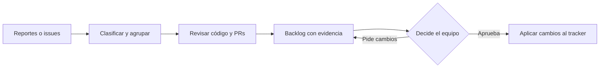

# triage-backlog

**De reportes sueltos a un backlog que el equipo puede decidir, con evidencia del código.**

Una skill de Claude Code para relevar bugs y pedidos de features, revisar qué existe en el front y el back, y proponer prioridades. También sirve para ordenar un backlog viejo: distingue lo pendiente, lo ya implementado, lo obsoleto y lo que tiene un PR esperando review.

**[Ver un backlog completo con datos ficticios](triage-backlog/references/ejemplo-backlog.md) · [Ver mi trabajo y contactarme](https://tomas-garbarino.vercel.app/)**

## Qué problema resuelve

Un issue abierto no siempre significa trabajo pendiente. Puede estar resuelto en la rama principal, depender de una decisión de producto o tener un arreglo listo que nadie revisó. A la vez, los pedidos nuevos pueden llegar por un tracker, un chat o un formulario.

La skill cruza esos reportes con el código y el historial para que la persona a cargo pueda decidir qué hacer primero. **El resultado inicial es un borrador: no modifica código ni cambia el tracker sin aprobación.**

## Entrada → trabajo → resultado

| Entrada | Qué revisa | Qué entrega |
| --- | --- | --- |
| Un bug reportado | Flujo, causa probable, evidencia `archivo:línea` y confianza. | Propuesta de arreglo, prioridad, riesgo y criterios de aceptación. |
| Un pedido de feature | Problema de fondo, código reutilizable, capas afectadas y dependencias. | Ticket funcional y propuesta técnica para decidir el alcance. |
| Un backlog existente | Estado contra la rama revisada y PRs abiertos. | Qué sigue pendiente, qué está parcial y qué conviene revisar o cerrar. |

Las prioridades P0–P3 son sugeridas y tienen una justificación. Bugs y features usan criterios distintos. Las preguntas sobre producción o decisiones de producto quedan visibles, sin inventar respuestas.



## Mirá una salida antes de instalar

El [ejemplo público](triage-backlog/references/ejemplo-backlog.md) usa una app inventada, **Acme Tareas**, y datos ficticios. Incluye:

- un bug de permisos cuyo arreglo tiene un PR pendiente de review;
- issues ya implementados que siguen abiertos;
- una exportación bloqueada por decidir qué puede ver cada rol;
- tablas de prioridades, detalle de P0/P1 y decisiones pendientes.

Sirve para evaluar el formato y el razonamiento esperado. No es evidencia de incidentes, clientes ni resultados de un producto real.

## Qué necesitás

- **Claude Code**, con acceso autorizado al código del proyecto. Esta es una skill de instrucciones y plantillas, no una aplicación ni un servicio alojado.
- **GitHub CLI (`gh`)** con acceso de lectura si los reportes o PRs están en GitHub.
- Para Jira, Linear, Slack o Teams: el conector disponible en tu agente o un export de los reportes. También podés pegar el texto en el chat.

## Instalación

Cloná este repo y copiá la carpeta de la skill al proyecto donde la vas a usar. Estos comandos parten de la carpeta donde querés descargarla:

**macOS / Linux — para el proyecto:**

```bash
git clone https://github.com/tomigarbarino/triage-backlog.git
mkdir -p <tu-repo>/.claude/skills
cp -r triage-backlog/triage-backlog <tu-repo>/.claude/skills/
```

**Windows / PowerShell — para el proyecto:**

```powershell
git clone https://github.com/tomigarbarino/triage-backlog.git
New-Item -ItemType Directory -Force "<tu-repo>/.claude/skills" | Out-Null
Copy-Item -Recurse "./triage-backlog/triage-backlog" "<tu-repo>/.claude/skills/"
```

Reemplazá `<tu-repo>` por la ruta de tu proyecto. Si ya existe una instalación, revisala antes de copiar encima.

Para usarla en todos tus proyectos, el destino es `~/.claude/skills/` en macOS/Linux o `$env:USERPROFILE/.claude/skills/` en PowerShell. No necesitás `npm install` para esta skill.

## Primera corrida

Abrí Claude Code en el repo de tu aplicación:

```text
/triage-backlog setup
```

El setup detecta el stack y pregunta de dónde salen los reportes, dónde vive el tracker, quién aprueba, cuáles son los flujos críticos y en qué idioma entregar los tickets. Prueba las fuentes disponibles y, con tu OK, guarda `.claude/triage.yml`. Commiteá ese archivo (y `.claude/skills/triage-backlog/` si está ahí), no la carpeta `.claude/` entera.

Después:

```text
/triage-backlog
```

Podés pedir, por ejemplo:

- «revisá el backlog y decime qué ya está resuelto»;
- «relevá los bugs y pedidos abiertos y proponé prioridades»;
- «analizá este bug: <reporte pegado>»;
- «qué implica esta feature y dónde entraría: <pedido>».

El backlog deja constancia de la rama y el commit revisados. Si hay más de 60 ítems (`limites.max_items_por_corrida`), propone un recorte y corre por tandas. Antes de crear tickets, aplicar labels o cerrar issues, la persona a cargo decide por ítem en la tabla **Decisiones** del backlog, y después:

```text
/triage-backlog aplicar
```

Muestra la lista exacta de acciones y las aplica con tu OK en el chat. Las revisiones de PRs se proponen por separado; mergear es un OK aparte por PR, y las migraciones no se aplican nunca desde la skill.

## Qué podés evaluar en este repo

| Archivo | Qué muestra |
| --- | --- |
| [Skill](triage-backlog/SKILL.md) | Setup, análisis, evidencia, prioridades y aprobación. |
| [Plantilla de configuración](triage-backlog/config-template.yml) | Adaptación a fuentes, repos, tracker y reglas de cada equipo. |
| [Ejemplos de configuración](triage-backlog/config-examples.md) | Monorepo y front/back separados. |
| [Plantilla de backlog](triage-backlog/backlog-template.md) | Entregable esperado y decisiones que quedan para el equipo. |
| [Brief de los lotes](triage-backlog/references/brief-subagente.md) | Prompt fijo de los agentes de solo lectura que revisan el código. |
| [Comandos](triage-backlog/references/comandos.md) | Los comandos de `gh` y git que usa la skill. |
| [Ejemplo ficticio](triage-backlog/references/ejemplo-backlog.md) | Una salida completa que se puede leer sin instalar nada. |

## Alcance y límites

- El estado del código no confirma por sí solo qué está desplegado, qué migraciones se aplicaron ni cómo están los datos reales.
- El diagnóstico puede ser una hipótesis: la salida debe indicar confianza y qué falta verificar. Se revisan especialmente los P0/P1 y los cierres propuestos.
- Un backlog grande puede consumir muchos tokens. Como referencia declarada por el autor, una corrida utilizó unos 350 mil tokens en subagentes; no es un costo fijo ni un presupuesto garantizado.
- No publica datos personales ni credenciales en los ejemplos o tickets. El equipo debe revisar qué configuración y reportes conviene versionar.
- La skill está escrita en español; el idioma de los tickets se configura. No hay una suite de tests ejecutables en este repo: la revisión se hace sobre las instrucciones, las plantillas y la evidencia de cada corrida.

## Adaptarlo a tu equipo

El punto de partida es un backlog concreto, los repos a revisar y quién toma la decisión. Se puede ajustar la escala de prioridades, las fuentes y el formato del ticket sin convertir cada reporte en una implementación automática.

**[Ver otros proyectos y conversar sobre tu flujo](https://tomas-garbarino.vercel.app/)**

## Licencia

[MIT](LICENSE).
