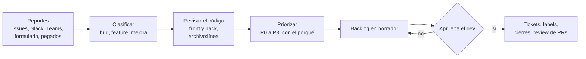

# triage-backlog

Una skill de Claude Code que convierte reportes de bugs y pedidos de features en un backlog priorizado, revisando el código de verdad. También sirve para re-triagear un backlog viejo: te dice qué sigue pendiente, qué ya está resuelto y qué tiene un PR esperando review.

Funciona con cualquier app. La primera vez corrés `/triage-backlog setup`, contestás unas preguntas y queda conectada a tu proyecto.



## Qué hace

- **Junta los reportes** de donde estén: issues de GitHub, Jira o Linear, un canal de Slack o Teams, un formulario, la pantalla de reportes de tu app, o texto pegado en el chat.
- **Clasifica** cada uno: bug, feature, mejora, deuda o épica. Agrupa duplicados.
- **Revisa el código del front y del back.** Para un bug, marca la causa probable con `archivo:línea` y un nivel de confianza. Para una feature, dónde entraría, qué se puede reusar y cuánto esfuerzo lleva.
- **Verifica el estado real** de cada ítem contra el código, no contra lo que dicen los comentarios: pendiente, parcial, hecho, PR listo u obsoleto.
- **Prioriza** de P0 a P3, con una línea de por qué. Bugs y features tienen criterios distintos (una feature nunca es P0).
- **Arma un backlog en borrador**: lo más importante arriba, las preguntas que bloquean, tablas por prioridad, lo que hay que decidir, lo que se puede cerrar, y el detalle completo de P0 y P1, con el ticket funcional (historia de usuario para las features).
- **Espera tu aprobación.** Recién ahí crea tickets, aplica prioridades y cierra lo resuelto. Si hay PRs listos, ofrece revisarlos.

Tres reglas fijas:

1. **Nada se crea, cierra ni mergea sin OK.** El backlog es una propuesta; la prioridad final es del dev a cargo.
2. **El código manda.** El estado sale del código y del historial de git. Si un comentario dice "ya está mergeado" y no es cierto, lo marca.
3. **Lo que no ve, lo pregunta.** No inventa el estado de producción (migraciones aplicadas, configuración, datos reales): lo deja como pregunta arriba del backlog.

## Un caso real

La primera corrida fue sobre el backlog de un producto en producción: 64 issues abiertos y 7 PRs (antes de que existiera el tope de 60 por corrida; hoy lo haría en dos tandas). Tardó unos 10 minutos, con 7 subagentes revisando el código en paralelo. Encontró:

- **4 fallas de seguridad graves**, con el arreglo ya escrito en PRs que nadie había revisado.
- **12 issues ya resueltos** en la rama principal, que seguían abiertos porque los comentarios decían otra cosa.
- **Un riesgo en producción:** código deployado que dependía de migraciones que quizás no estaban aplicadas.
- **2 issues bloqueados** por una decisión de producto que nadie había tomado.

Leyendo los issues uno por uno, casi nada de eso aparece. Hay un ejemplo de backlog con datos ficticios en [triage-backlog/references/ejemplo-backlog.md](triage-backlog/references/ejemplo-backlog.md).

## Qué necesitás

- [Claude Code](https://claude.com/claude-code), abierto en el repo de tu app. Si front y back están en repos separados, cloná los dos: el setup te pregunta dónde está el otro.
- Para GitHub: el [GitHub CLI](https://cli.github.com) (`gh`) con sesión iniciada.
- Para Jira, Linear, Slack o Teams: el conector correspondiente en Claude, o un export de los reportes.

## Instalación

**Para todo el equipo** (recomendado): la skill queda en el repo de tu app y la usa cualquiera que abra Claude Code ahí.

```bash
git clone https://github.com/tomigarbarino/triage-backlog.git
mkdir -p <tu-repo>/.claude/skills/triage-backlog
cp -r triage-backlog/triage-backlog/. <tu-repo>/.claude/skills/triage-backlog/
```

**Solo para vos**, en todos tus proyectos:

```bash
git clone https://github.com/tomigarbarino/triage-backlog.git
mkdir -p ~/.claude/skills/triage-backlog
cp -r triage-backlog/triage-backlog/. ~/.claude/skills/triage-backlog/
```

En Windows (PowerShell):

```powershell
git clone https://github.com/tomigarbarino/triage-backlog.git
# para el equipo
New-Item -ItemType Directory -Force "<tu-repo>\.claude\skills\triage-backlog" | Out-Null
Copy-Item -Recurse -Force "triage-backlog\triage-backlog\*" "<tu-repo>\.claude\skills\triage-backlog\"
# solo para vos
New-Item -ItemType Directory -Force "$env:USERPROFILE\.claude\skills\triage-backlog" | Out-Null
Copy-Item -Recurse -Force "triage-backlog\triage-backlog\*" "$env:USERPROFILE\.claude\skills\triage-backlog\"
```

Sin git: descargá el ZIP del repo y copiá la carpeta `triage-backlog/` a `.claude/skills/triage-backlog/`. Los mismos comandos sirven para reinstalar o actualizar.

## Uso

**1. Setup** (una vez por proyecto). En Claude Code, dentro del repo:

```
/triage-backlog setup
```

Lee el repo (stack, carpetas, rama viva, tracker) y te pregunta en uno o dos mensajes, con respuestas sugeridas:

- de dónde salen los reportes;
- dónde viven los tickets: GitHub, Jira, Linear o ninguno (en ese caso te deja un archivo para importar);
- la rama desde la que deployás y dónde está clonado cada repo;
- quién aprueba el backlog, quién aprueba el alcance de las features y, si querés que te lo mande, en qué canal (el nombre, nunca webhooks);
- cuáles son los flujos críticos, qué es siempre P0, y si tu equipo usa otra escala (alta/media/baja);
- las URL de staging y prod (solo para chequeos de lectura), en qué idioma van los tickets y dónde guardar el backlog.

Prueba las fuentes leyendo los últimos reportes y deja todo en `.claude/triage.yml`. Commiteá ese archivo (y `.claude/skills/triage-backlog/` si está ahí), no la carpeta `.claude/` entera: `settings.local.json` y otros archivos locales no van.

**2. Triage** (cuando quieras).

```
/triage-backlog
```

O pedidos como:

- "relevá los bugs y pedidos abiertos y armame el backlog"
- "revisá el backlog y decime qué ya está resuelto"
- "triageá este bug: <reporte pegado>"
- "cuánto cuesta esta feature y dónde entra: <pedido>"

Si hay más de 60 ítems (configurable en `limites.max_items_por_corrida`), te propone un recorte y corre por tandas.

**3. Decisión.** Abrís el backlog y completás la tabla **Decisiones** del final: aprobado, cambiar prioridad, pedir más info, cerrar o descartar. Después:

```
/triage-backlog aplicar
```

Te muestra la lista exacta de acciones (crear, cerrar, labels, comentarios) y las aplica con tu OK en el chat. Mergear un PR es un OK aparte, por PR.

## Archivos

| Archivo | Qué es |
|---|---|
| [triage-backlog/SKILL.md](triage-backlog/SKILL.md) | La skill: setup, los 8 pasos del triage y los cuidados |
| [triage-backlog/config-template.yml](triage-backlog/config-template.yml) | Plantilla de `.claude/triage.yml`, comentada |
| [triage-backlog/config-examples.md](triage-backlog/config-examples.md) | Dos configs de ejemplo: monorepo y front/back separados |
| [triage-backlog/backlog-template.md](triage-backlog/backlog-template.md) | Formato del backlog que entrega |
| [triage-backlog/references/brief-subagente.md](triage-backlog/references/brief-subagente.md) | Prompt fijo de los lotes que revisan el código |
| [triage-backlog/references/comandos.md](triage-backlog/references/comandos.md) | Comandos de `gh` y git que usa la skill |
| [triage-backlog/references/ejemplo-backlog.md](triage-backlog/references/ejemplo-backlog.md) | Un backlog de ejemplo, con datos ficticios |

## ¿Ya existe algo así?

Hay varias skills de triage para agentes, y cada una cubre una parte:

- `bug-triage` (skillmds) lee issues con `gh`, puntúa impacto, frecuencia y costo, y agrupa duplicados.
- `gh-triage` (bmad) prioriza por severidad, agrupa por temas y procesa en lotes paralelos.
- `triage` (mattpocock) mueve issues por un flujo de labels.
- Una [charla de DevConf.IN 2026](https://pretalx.devconf.info/devconf-in-2026/talk/FV3PRW/) presenta una GitHub Action que analiza issues con el código como contexto y sugiere arreglos.

Esta se diferencia en que:

- verifica cada ítem contra el código y detecta lo hecho o con PR;
- trata bugs y features con criterios distintos y entrega tickets funcionales;
- se conecta a cada proyecto con un setup;
- nunca decide sola.

## Límites

- No ve producción más allá de chequeos de lectura a URL públicas (página, `health`). Lo que depende de ella queda como pregunta.
- Los subagentes que revisan el código en paralelo se pueden equivocar. La skill vuelve a verificar lo que queda P0, P1 o "cerrar después de verificar", pero revisá la evidencia antes de aprobar.
- En backlogs grandes consume tokens: el caso de arriba usó unos 350 mil en subagentes. Por eso corta en 60 ítems por corrida y propone tandas.
- Está escrita en español rioplatense (con voseo). Los tickets salen en el idioma que elijas en el setup.

## Licencia

[MIT](LICENSE)
